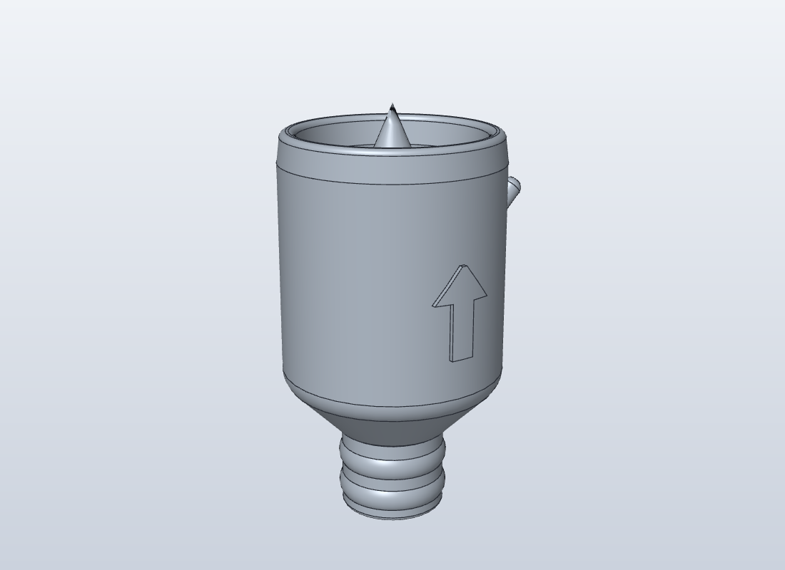
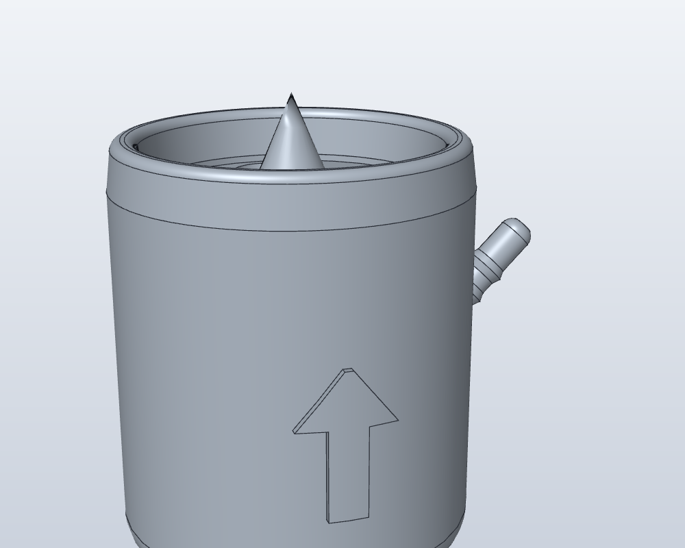
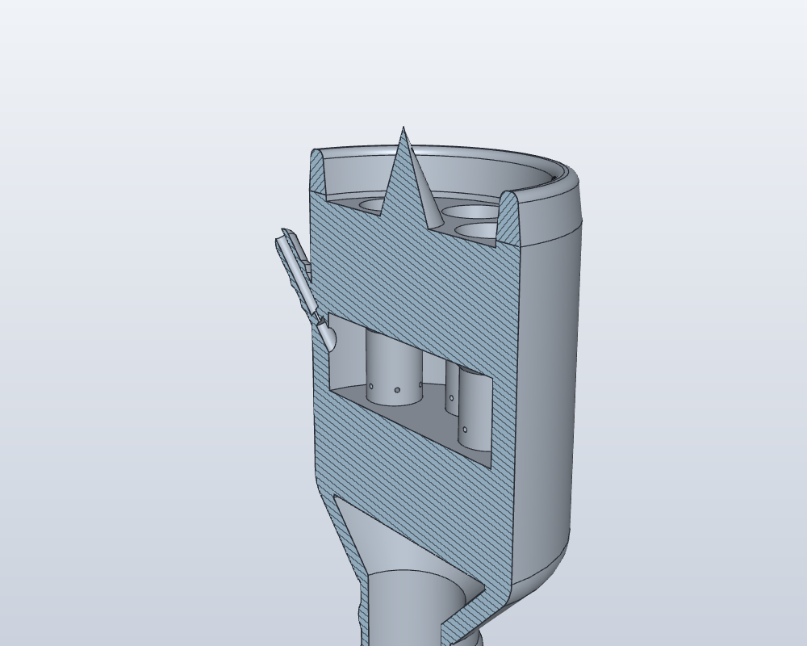
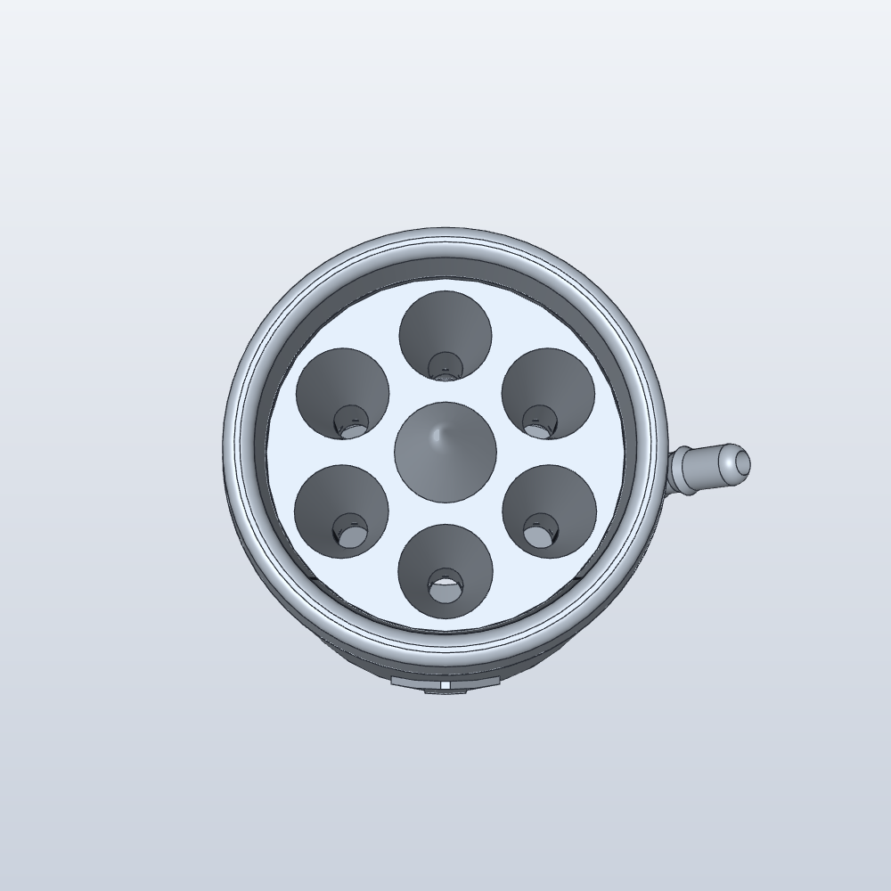

# Venturi aerator — 6-throat open-ended microbubble injector

A printable Venturi aerator for the **VIVOHOME 120 W 2700 GPH** pump, modelled in
SolidCraft as a fully parametric design (79 named parameters, 112 features).
The current, recommended build is **`Venturi-Aerator-v4-open-ended`**: fine-bubble
throats, metered air, and an open flared discharge for submerged use.



## Specs

| | |
|---|---|
| Inlet | 1" hose barb, 20 mm bore, rounded clamp ridges |
| Outlet | **Open** flared bowl (no top barb): floor at z = 83.36, rim at z ≈ 91.4, Ø ≈ 40 mm clear aperture around the post |
| Air inlet | 3/16" barb at 45°, Ø3.0 feed bore with a **Ø0.7 metering orifice** |
| Throats | 6 × **Ø4.5 mm × 13.5 mm** (3 × d) on a 14 mm ring |
| Nozzle / diffuser | 10° / 10° half-angle |
| Air injection | 36 × **Ø0.8 mm** holes — 6 per throat, 3 diametral pairs — at 20 % of the throat length |
| Air chamber | Ø42 internal cavity around the throat tubes |
| Impingement | Ø12 cone, apex z = 97.35, base z = 84.36, standing in the open bowl |
| Housing | Ø52 mm, r6 fillets, 5 mm wall over the air chamber |
| Tube roots | 1.5–1.8 mm 45° bevels where the throats meet the air-chamber ceiling |
| Print aids | 1.0 mm plenum-roof cove and 0.5 mm inlet-barb shoulder chamfers |
| Flow arrow | Raised 1.0 mm arrow on the barrel, inlet → outlet |
| Printable size | Ø52 × 97.35 mm (the discharge post is the highest point) |
| Volume / mass | **97,671.8 mm³ / 126.0 g** in PETG |
| Source | 79 parameters, 112 timeline features, no magic numbers in the features |



## Pump curve and operating point

The 2700 GPH figure is the *zero-head* rating. The VIVOHOME 120 W pump's
published curve is:

| Head (ft) | 0 | 1.6 | 3.3 | 4.9 | 6.6 | 8.2 | 9.8 | 11.5 | 13.1 | 15 |
|---|---|---|---|---|---|---|---|---|---|---|
| Flow (GPH) | 2700 | 2325 | 1982 | 1638 | 1295 | 978 | 700 | 462 | 264 | 0 |

Solving that curve against the six-throat restriction puts the real operating
point near **957 GPH**, not 2700 GPH: throat velocity ≈ **10.5 m/s**, throat
static pressure ≈ **66 kPa absolute**. The earlier Ø5.5 design would run near
1161 GPH at 8.6 m/s, so the smaller throats trade about 18 % of flow for a
substantially finer plume.

Bubble size is estimated from the pressure drop available for air breakup:
the Ø4.5 throats give a maximum stable bubble diameter on the order of
**87 µm**, versus ≈112 µm at Ø5.5. Going smaller helps only marginally and
costs flow, so Ø4.5 is the recommended compromise.

| `D_throat` | Flow (GPH) | Throat velocity | Est. max bubble |
|---|---|---|---|
| 5.5 mm | 1161 | 8.57 m/s | 112 µm |
| **4.5 mm (current)** | **957** | **10.54 m/s** | **87 µm** |
| 4.0 mm | 830 | 11.58 m/s | 78 µm |
| 3.5 mm | 691 | 12.58 m/s | 71 µm |

The original air path was heavily over-fed: a Ø3.0 feed bore plus 36 × Ø1 holes
could admit roughly as much air (by volume) as water. A **Ø0.7 metering orifice**
in the air barb cuts the feed area about **18×**, so the holes behave as fine
injectors instead of a froth generator. The air barb is set back with an 8 mm
web and a 2 mm land so the orifice is a real restriction, not a leak around the
joint.



## Open discharge

The collector and top hose barb are cut away, leaving a flared bowl around the
impingement cone. Water leaves over the rim around the post: net discharge area
is about **1240 mm²**, so exit velocity is ≈0.8 m/s at 957 GPH, rather than
≈3.2 m/s through the old Ø20 outlet. That corresponds to only about **0.5 m** of
dynamic head recovered — the earlier claim of 3.5–4 m was based on the nameplate
flow and was overstated. The open end is intended for **submerged discharge**;
it keeps the six throats, air metering and flow arrow and drops only the top
fitting.



## Printing

Print **upright**: inlet barb tip on the bed, open bowl up.
PETG or ASA, 0.2 mm layers, 5 perimeters, solid. No supports needed — the outer
bolster is a 45° cone and the air barb is angled 45°.

Two internal bridges want full part cooling: the plenum roof and the air-chamber
ceiling. The plenum rim gets a 1.0 mm 45° cove; the air-chamber ceiling perimeter
cannot take one because the tube-root bevels already reach the wall, so it stays
a bridge between the wall and the six blended roots.

## Tuning

`D_throat` is the first knob. Everything downstream follows it: throat length,
nozzle and diffuser length, tube wall, air-hole height and air-barb position all
recompute. The table above gives the expected flow/bubble trade. Below about
Ø4.0 mm the pump loses too much flow and the throat approaches air-release /
cavitation conditions, so Ø4.5 mm is the default.

`D_air_meter` (0.7 mm) sets air flow; `D_air_hole` (0.8 mm) sets how finely it is
distributed. Opening the meter too far reintroduces coarse, frothy bubbles;
closing it starves the throats. `s_air_web` / `L_air_web` control the metering
land. `A_conv` / `A_div`, `n_throat`, `R_ring`, `R_imp` / `L_imp` and
`R_b2` / `L_b2` are the other useful knobs.

The flow arrow is parametric: `arrow_z`, `arrow_len`, `arrow_head`, `arrow_w`,
`arrow_shaft_w`, `arrow_tip_w`, `arrow_rib`. `arrow_ang` is fixed at 270° (the
front); the sketch plane's axes are numeric, so moving it to another side means
re-aiming the plane.

> Note: SolidCraft's `check_parameters` reports false fillet errors on this
> model. Real parameter edits (`set_parameter`, `parameters.change`) rebuild
> correctly — use those when tuning.

## Verification

- Two closed, valid bodies: main shell (113 faces) plus the flared lip (6 faces);
  no feature errors. Two legacy fillets (`FilletOut`, `AirBarbTip`) remain
  suppressed in the source design.
- The exported STL is a single watertight shell (157,306 triangles). Six hidden
  remnant bodies produced by the open-end cut are deleted in the final
  `RemoveOpenEndFragments` feature, so they are not in the STEP/STL.
- Ray checks: vertical axis hits the post apex at z = 97.35; at z = 90 a radial
  ray reaches the lip at r ≈ 25.3; the bowl floor is z = 83.36 at r = 15–20.
- Inherited from the fine-bubble inline design: all 36 air holes open into the
  throats; the water bores pass a ray at r = 2.1 mm and block at r = 2.35 mm;
  the air meter passes on-axis and blocks off-axis; the arrow stands 1.0 mm
  proud of the barrel.

## Files

```
cad/Venturi-Aerator-v4-open-ended.sc    current parametric source (rebuilds on open)
cad/Venturi-Aerator-v4-open-ended.step  STEP
stl/Venturi-Aerator-v4-open-ended.stl   printable mesh
parameters-v4-open-ended.csv            all 79 named parameters
images/V4-open-ended-*.png              renders and section

cad/Venturi-Aerator-v3.sc               legacy inline source (Ø5.5, unmetered air)
cad/Venturi-Aerator-v3-open.sc          legacy open source (z_open = 86.5)
cad/Venturi-Aerator-v3*.step            legacy STEP exports
stl/Venturi-Aerator-v3*.stl             legacy printable meshes
parameters*.csv                         legacy parameter exports
images/AeratorV3-*.png                  legacy renders
```

## Differences from the OpenSCAD source

The original `venturi_aerator_v3.scad` is the starting point. Intentional
deviations now include:

- The 3/16" barb's two ridges are triangular (0.5 mm high × 2.5 mm wide) rather
  than sine-shaped; a torus at that size would need `minor > major`. The 1" barb
  ridges are true torus arcs (0.8 × 5 mm), matching the sine profile within
  ~0.01 mm.
- The SCAD's 0.01 mm tool overlaps are 0.05 mm here, which keeps the booleans
  clean with no visible effect.
- The plenum-roof rim (1.0 mm) and inlet-barb shoulder (0.5 mm) chamfers are
  additions for printing; the SCAD leaves those edges sharp.
- Throats reduced from Ø5.5 to Ø4.5, air holes from Ø1.0 to Ø0.8, and an Ø0.7
  metering orifice added in the air barb for the pump's real operating point.
- The top barb and collector are replaced by a flared open bowl sized for
  submerged discharge.

## License

CC BY 4.0 — see [LICENSE](LICENSE).
