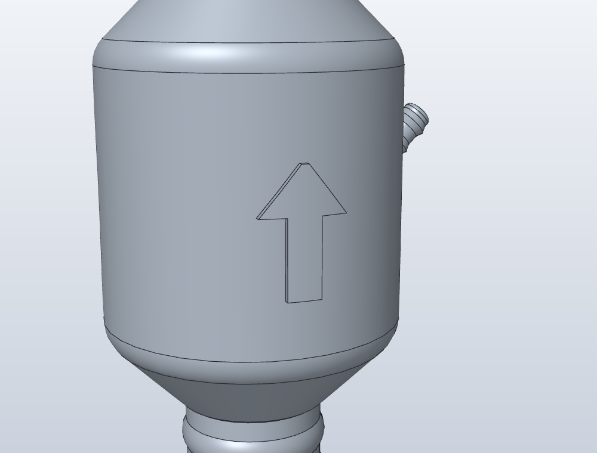
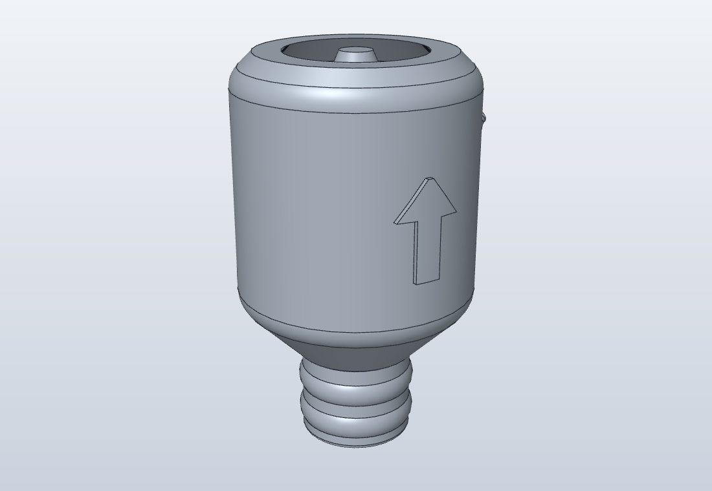
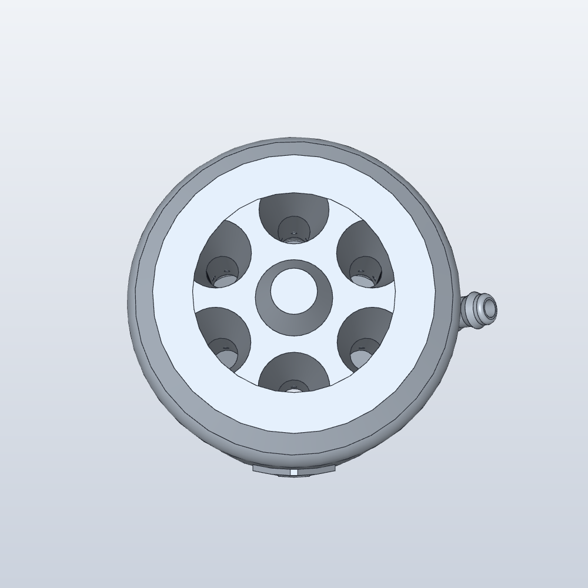
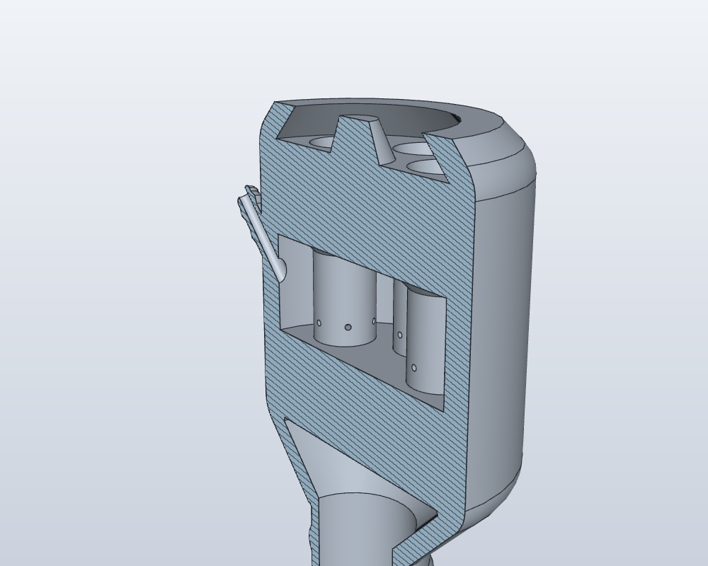

# Venturi aerator — 6-throat microbubble injector

A printable multi-throat Venturi aerator for a **2700 GPH** pump, using SolidCraft as a fully parametric model
(76 named parameters in the inline model; the open variant adds `z_open`, no magic numbers in the features).


## Specs

| | |
|---|---|
| Inlet / outlet | 1" hose barbs, 20 mm bore, short rounded ridges for hose clamps |
| Air inlet | 3/16" hose barb at 45°, 1.5 mm feed bore |
| Throats | 6 × Ø5.5 mm × 16.5 mm long (3 × d) on a 14 mm ring |
| Nozzle / diffuser | 10° half-angle on both sides |
| Air injection | 36 × Ø1 mm holes — 6 per throat, 3 diametral pairs — at 20 % of the throat length |
| Air chamber | Ø42 × 16.5 mm internal cavity around the throat tubes |
| Impingement | Ø12 × 14 mm cone in the outlet chamber |
| Housing | Ø52 mm; 45° bolster cones into both barbs; r6 fillets; 5 mm wall over the air chamber |
| Tube roots | 1.5–1.8 mm 45° bevels where the throat tubes meet the air-chamber ceiling |
| Chamfers | 1.0 mm 45° cove at the plenum-roof rim and 0.5 mm at the inlet-barb shoulder (print aids) |
| Flow arrow | Raised 1.0 mm arrow on the barrel, pointing inlet → outlet |
| Overall size | Ø52 × 114.7 mm tall (inline); Ø52 × 86.5 mm (open) |
| Volume / mass | 97,175.0 mm³ / 125.4 g inline; 89,502.5 mm³ / 115.5 g open, in PETG |



## How it works

Water enters the bottom barb, opens through a 45° expansion into a plenum, and is
forced through six 10° nozzles into six Ø5.5 mm throats. The throats pass
through a sealed air chamber; each throat is drilled by six Ø1 mm holes at 20 %
of its length, so air is drawn from the chamber into the highest-velocity part of
the jet. The six diffusers (10°) discharge into a 45° collector and out the top
barb. A 12 mm cone sits in the collector to shear the plume once more before it
leaves. In the open variant the collector and top barb are cut away at
`z_open` = 86.5 mm, so the same cone remains as a 5.8 mm impingement post in an
open Ø30.6 mm bowl.

The 6 throats give **142.5 mm²** of flow area — about 19.9 m/s at 2700 GPH,
roughly twice the area (and half the velocity) of a single 3/8" throat. That
keeps the venture out of hard cavitation while still breaking bubbles down.


## Printing

Print **upright**: inlet barb tip on the bed, outlet (barb or open bowl) up.
PETG or ASA, 0.2 mm layers, 5 perimeters, solid. No supports needed — the outer
bolster is already a 45° cone and the air barb is angled 45°.

Two internal bridges want full part cooling: the plenum roof and the air-chamber
ceiling. The plenum rim gets a 1.0 mm 45° cove; the air-chamber ceiling perimeter
cannot take one because the tube-root bevels already reach the wall (the largest
that fits is 0.04 mm), so it is left as a bridge between the wall and the six
blended roots.

## Tuning

`D_throat` is the first knob (5.0 / 5.5 / 6.0 mm). Everything downstream follows
it: throat length, nozzle and diffuser length, tube wall, air-hole height and the
air-barb position all recompute.

| `D_throat` | Volume | Throat area |
|---|---|---|
| 5.0 mm | 100,832.1 mm³ | 117.8 mm² |
| 5.5 mm | 97,175.0 mm³ | 142.5 mm² |
| 6.0 mm | 93,353.9 mm³ * | 169.6 mm² |

\* At 6.0 mm the two 1.8 mm tube-root bevels no longer fit (the largest that
fits there is 1.599 mm), so those features report an error and the volume is
taken without them. Set all three bevels to 1.5 mm first: 6.0 mm then builds
cleanly at 93,562.4 mm³ with all 36 air holes — or stay at 5.5 mm. The plenum
cove still fits at 6.0 mm.

Other useful knobs: `A_conv` / `A_div` (cone angles), `n_throat`, `R_ring`,
`D_air_hole`, `R_imp` / `L_imp` (impingement cone), `R_b2` / `L_b2` (air barb).
The two new chamfers are the `ChamferPlenum` (1.0 mm) and `ChamferBarbShoulder`
(0.5 mm) features.

The flow arrow is parametric too: `arrow_z`, `arrow_len`, `arrow_head`, `arrow_w`,
`arrow_shaft_w`, `arrow_tip_w`, `arrow_rib`. `arrow_ang` is fixed at 270° (the
front); the sketch plane's axes are numeric, so moving it to another side means
re-aiming the plane.

> Note: SolidCraft's `check_parameters` reports false fillet errors on this
> model. Real parameter edits (`set_parameter`, `parameters.change`) rebuild
> correctly — use those when tuning.

## Variants

Two bodies are included, built from the same feature tree.

| | Inline | Open |
|---|---|---|
| Outlet | 1" hose barb | 45° open bowl |
| Height | 114.7 mm | 86.5 mm |
| Volume / mass | 97,175.0 mm³ / 125.4 g | 89,502.5 mm³ / 115.5 g |
| Discharge | Ø20 bore (314 mm²) | Ø30.6 aperture (≈695 mm² net of the post) |
| Impingement | 14 mm cone, apex at 94.7 | 5.8 mm post, Ø7.1 flat top |
| Use | inline with a return hose / waterfall | submerged, open discharge |

The **open** variant is the same model with a cylinder intersection at `z_open`
(86.5 mm), so it keeps the arrow, the six throats and the impingement post but
drops the collector and 1" outlet. Removing the outlet takes the discharge from
Ø20 (9.0 m/s at 2700 GPH) to Ø30.6 (≈4.1 m/s), recovering roughly 3.5–4 m of
head. Change `z_open` to move the cut: lower leaves a shorter post, higher leaves
a taller post and a smaller bowl rim.





## Verification

- Inline: 1 closed body, 1 shell, 122 faces, no feature errors.
- Open: 1 closed body, 1 shell, 114 faces, no feature errors; bbox max z = 86.50.
- Chamfer checks: the plenum cove adds 45.3 mm³ and the shoulder 9.7 mm³; both
  are 45° and the body stays closed.
- Water path: inlet bore open into the plenum; all six throat bores pass a ray at
  r = 2.70 mm and block at r = 2.85 mm; all six paths reach the collector.
- Air chamber confirmed hollow (rays hit exactly r = 21 mm, floor 48.6, roof
  65.1); barb bore open, and all **36** air holes open into the throats
  (9 coaxial groups × 4 faces).
- Axis ray stops on the impingement cone apex at z = 94.68.
- Flow arrow stands 1.0 mm proud of the barrel (rays hit r = 27.0 on the arrow,
  r = 26.0 beside it) and the air-barb envelope is unchanged.




## Files

```
cad/Venturi-Aerator-v3.sc        parametric inline source (rebuilds on open)
cad/Venturi-Aerator-v3-open.sc   parametric open source (adds z_open)
cad/Venturi-Aerator-v3.step      inline STEP
cad/Venturi-Aerator-v3-open.step open STEP
stl/Venturi-Aerator-v3.stl       printable inline mesh
stl/Venturi-Aerator-v3-open.stl  printable open mesh
parameters.csv                   all 76 named parameters (inline)
parameters-open.csv              all 77 (adds z_open)
images/                          renders and sections
```

## Differences from the OpenSCAD source

The geometry matches `venturi_aerator_v3.scad`. Three intentional deviations:

- The 3/16" barb's two ridges are triangular (0.5 mm high × 2.5 mm wide) rather
  than sine-shaped; a torus at that size would need `minor > major`. The 1" barb
  ridges are true torus arcs (0.8 × 5 mm) matching the sine profile within
  ~0.01 mm.
- The SCAD's 0.01 mm tool overlaps are 0.05 mm here, which keeps the booleans
  clean with no visible effect.
- The plenum-roof rim (1.0 mm) and inlet-barb shoulder (0.5 mm) chamfers are
  additions for printing; the SCAD leaves those edges sharp.

## License

CC BY 4.0 — see [LICENSE](LICENSE).
