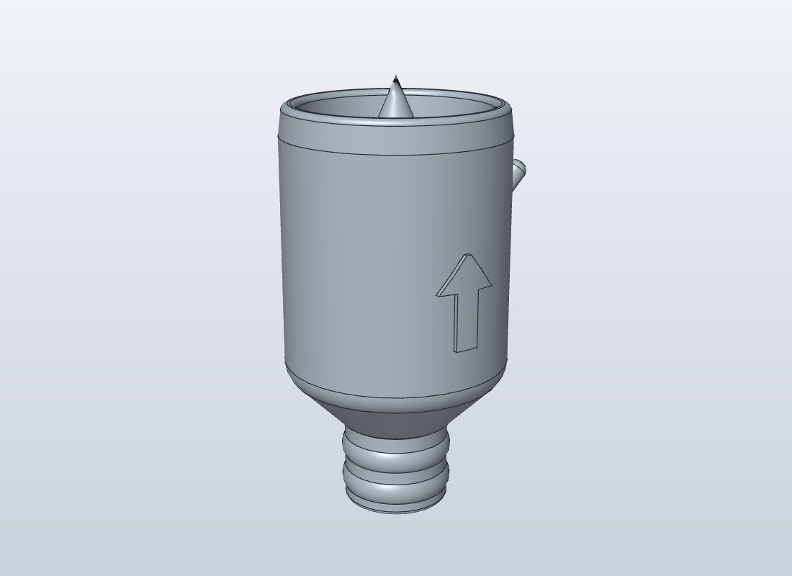
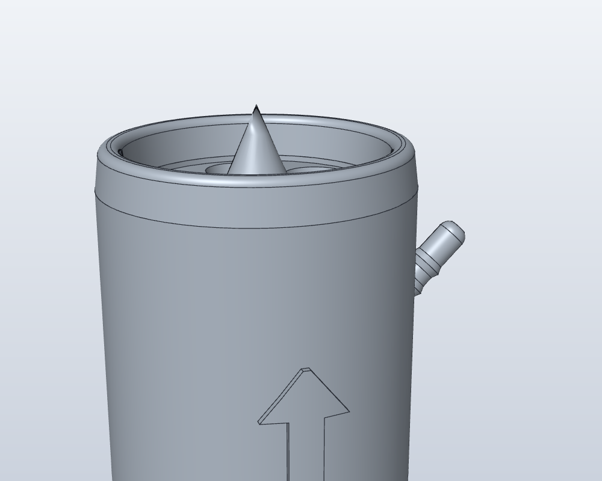
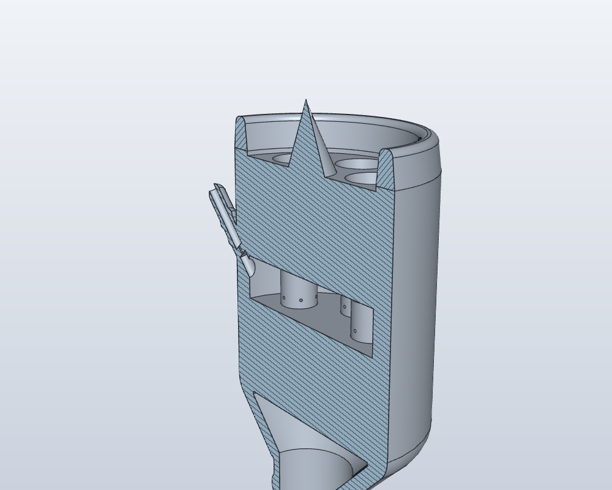
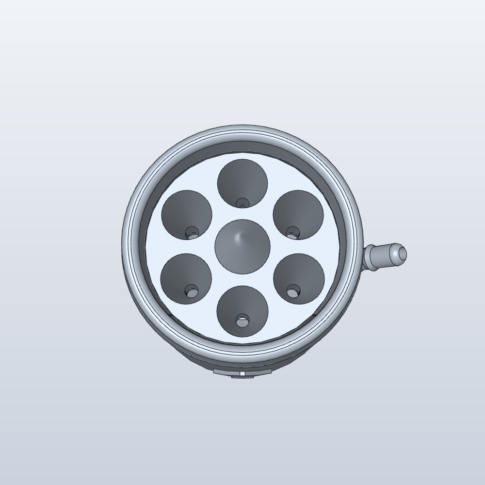

# Venturi aerator — 6-throat open-ended microbubble injector

A printable Venturi aerator for a **1400 GPH** pump, modelled in SolidCraft as a
fully parametric design (79 named parameters, 112 features). The current,
recommended build is **`Venturi-Aerator-v5-open-ended`**: smaller throats and a
smaller air meter than v4 so the venturi still reaches fine-bubble velocity at
the lower flow.



## Specs

| | |
|---|---|
| Design pump | **1400 GPH** (see the curve assumption below) |
| Inlet | 1" hose barb, 20 mm bore, rounded clamp ridges |
| Outlet | **Open** flared bowl (no top barb): floor z = 86.70, rim z ≈ 94.7, Ø ≈ 40 mm clear aperture around the post |
| Air inlet | 3/16" barb at 45°, Ø3.0 feed bore with a **Ø0.5 metering orifice** |
| Throats | 6 × **Ø3.25 mm × 9.75 mm** (3 × d) on a 14 mm ring |
| Nozzle / diffuser | 10° / 10° half-angle |
| Air injection | 36 × **Ø0.6 mm** holes — 6 per throat, 3 diametral pairs — at 20 % of the throat length |
| Air chamber | Ø42 internal cavity around the throat tubes |
| Impingement | Ø12 cone, apex z = 100.69, base z = 87.70, standing in the open bowl |
| Housing | Ø52 mm, r6 fillets, 5 mm wall over the air chamber |
| Tube roots | 1.5–1.8 mm 45° bevels where the throats meet the air-chamber ceiling |
| Print aids | 1.0 mm plenum-roof cove and 0.5 mm inlet-barb shoulder chamfers |
| Flow arrow | Raised 1.0 mm arrow on the barrel, inlet → outlet |
| Printable size | Ø52 × 100.69 mm (the discharge post is the highest point) |
| Volume / mass | **107,715.7 mm³ / 139.0 g** in PETG |
| Source | 79 parameters, 112 timeline features, no magic numbers in the features |



## Pump curve and operating point

The 2700 GPH rating was the *zero-head* figure of the old pump. For the 1400 GPH
pump no published curve was available, so the design assumes its curve has the
same shape as the old one, scaled by 1400/2700 ≈ 0.519:

| Head (ft) | 0 | 1.6 | 3.3 | 4.9 | 6.6 | 8.2 | 9.8 | 11.5 | 13.1 | 15 |
|---|---|---|---|---|---|---|---|---|---|---|
| Flow (GPH) | 1400 | 1206 | 1028 | 849 | 671 | 507 | 363 | 240 | 137 | 0 |

If you have the real curve for your pump, it is worth re-running this sizing —
the throat area should be chosen so the throat velocity stays near 10.5 m/s.

Solving that curve against the six-throat restriction puts v5 near **498 GPH**
at **≈2.5 m** of head, with throat velocity **10.53 m/s** and throat static
pressure ≈ **66 kPa absolute** — essentially the same throat conditions the
v4 design had at 957 GPH on the bigger pump. The resulting estimated maximum
stable bubble diameter is again on the order of **87 µm**.

Leaving v4's Ø4.5 throats on the 1400 GPH pump would drop the velocity to
≈8.6 m/s and weaken the air draw, which is why the throats were reduced.

| `D_throat` (6 throats) | Flow (GPH) | Throat velocity | Est. max bubble |
|---|---|---|---|
| 4.5 mm (v4) | 781 | 8.61 m/s | ~106 µm |
| 4.0 mm | 673 | 9.38 m/s | ~98 µm |
| 3.5 mm | 557 | 10.15 m/s | ~90 µm |
| **3.25 mm (v5)** | **498** | **10.53 m/s** | **~87 µm** |
| 3.0 mm | 441 | 10.92 m/s | ~84 µm |
| 2.75 mm | 383 | 11.31 m/s | ~81 µm |

The air path was scaled with the water flow: the Ø0.7 → **Ø0.5 mm** meter keeps
the same air-orifice-to-throat-area ratio as v4, and the Ø0.8 → **Ø0.6 mm**
holes keep the same hole-to-throat proportion. A Ø0.5 mm orifice is small for
FDM; if it prints closed or the throats sound air-starved, try Ø0.55–0.6 mm.
Too large, and the plume goes back to coarse froth.



## Open discharge

The collector and top hose barb are cut away, leaving a flared bowl around the
impingement cone. Water leaves over the rim around the post: net discharge area
is about **1240 mm²**, so at 498 GPH the exit velocity is ≈0.4 m/s rather than
≈1.7 m/s through the old Ø20 outlet — about 0.14 m of dynamic head. The open
end is intended for **submerged discharge**; it keeps the six throats, air
metering and flow arrow and drops only the top fitting.



## Printing

Print **upright**: inlet barb tip on the bed, open bowl up.
PETG or ASA, 0.2 mm layers, 5 perimeters, solid. No supports needed — the outer
bolster is a 45° cone and the air barb is angled 45°.

Two internal bridges want full part cooling: the plenum roof and the air-chamber
ceiling. The plenum rim gets a 1.0 mm 45° cove; the air-chamber ceiling perimeter
cannot take one because the tube-root bevels already reach the wall, so it stays
a bridge between the wall and the six blended roots.

Check the air meter and the 36 Ø0.6 holes after printing; the small orifices are
the most likely feature to close over with a hot or under-cooled nozzle.

## Tuning

`D_throat` is the first knob. Everything downstream follows it: throat length,
nozzle and diffuser length, tube wall, air-hole height and air-barb position all
recompute. The table above gives the expected flow/bubble trade for the 1400 GPH
pump; below about Ø3.0 mm the throttle costs too much flow.

`D_air_meter` (0.5 mm) sets air flow; `D_air_hole` (0.6 mm) sets how finely it is
distributed. `s_air_web` / `L_air_web` control the metering land. `A_conv` /
`A_div`, `n_throat`, `R_ring`, `R_imp` / `L_imp` and `R_b2` / `L_b2` are the other
useful knobs.

The flow arrow is parametric: `arrow_z`, `arrow_len`, `arrow_head`, `arrow_w`,
`arrow_shaft_w`, `arrow_tip_w`, `arrow_rib`. `arrow_ang` is fixed at 270° (the
front); the sketch plane's axes are numeric, so moving it to another side means
re-aiming the plane.

> Note: SolidCraft's `check_parameters` reports false fillet errors on this
> model. Real parameter edits (`set_parameter`, `parameters.change`) rebuild
> correctly — use those when tuning.

## Verification

- Two closed, valid bodies: main shell (113 faces) plus the flared lip (6 faces);
  no feature errors. Two legacy fillets (`FilletOut`, `AirBarbTip`) remain
  suppressed in the source design.
- The exported STL is a single watertight shell (144,234 triangles). Six hidden
  remnant bodies produced by the open-end cut are deleted by the final
  `RemoveOpenEndFragments` feature, so they are not in the STEP/STL.
- Ray checks: vertical axis hits the post apex at z = 100.69; at z = 92 a radial
  ray reaches the lip at r ≈ 25.5; the bowl floor is z = 86.70 at r = 15.
- All **36** air holes open into the throats (six directions × six throats); the
  water bores pass a ray on the throat axis and block at the 1.62 mm wall; the
  air meter passes on-axis and blocks 0.6 mm off-axis.

## Files

```
cad/Venturi-Aerator-v5-open-ended.sc    current parametric source (rebuilds on open)
cad/Venturi-Aerator-v5-open-ended.step  STEP
stl/Venturi-Aerator-v5-open-ended.stl   printable mesh
parameters-v5-open-ended.csv            all 79 named parameters
images/V5-open-ended-*.png              renders and section

cad/Venturi-Aerator-v4-open-ended.sc    legacy fine-bubble build for 2700 GPH pump
cad/Venturi-Aerator-v4-open-ended.step
stl/Venturi-Aerator-v4-open-ended.stl
parameters-v4-open-ended.csv
images/V4-open-ended-*.png

cad/Venturi-Aerator-v3*.sc/.step        original Ø5.5 unmetered variants
stl/Venturi-Aerator-v3*.stl             legacy printable meshes
parameters.csv / parameters-open.csv     legacy parameter exports
images/AeratorV3-*.png                  legacy renders
```

## Differences from the OpenSCAD source

The original `venturi_aerator_v3.scad` is the starting point. Intentional
deviations now include:

- The 3/16" barb's two ridges are triangular (0.5 mm high × 2.5 mm wide) rather
  than sine-shaped; a torus at that size would need `minor > major`. The 1" barb
  ridges are true torus arcs (0.8 × 5 mm), matching the sine profile within
  ~0.01 mm.
- The SCAD's 0.01 mm tool overlaps are 0.05 mm here, which keeps the booleans
  clean with no visible effect.
- The plenum-roof rim (1.0 mm) and inlet-barb shoulder (0.5 mm) chamfers are
  additions for printing; the SCAD leaves those edges sharp.
- Throats reduced from Ø5.5 to Ø3.25, air holes from Ø1.0 to Ø0.6, and a Ø0.5
  metering orifice added in the air barb to hold fine-bubble velocity on a
  1400 GPH pump.
- The top barb and collector are replaced by a flared open bowl sized for
  submerged discharge.

## License

CC BY 4.0 — see [LICENSE](LICENSE).
