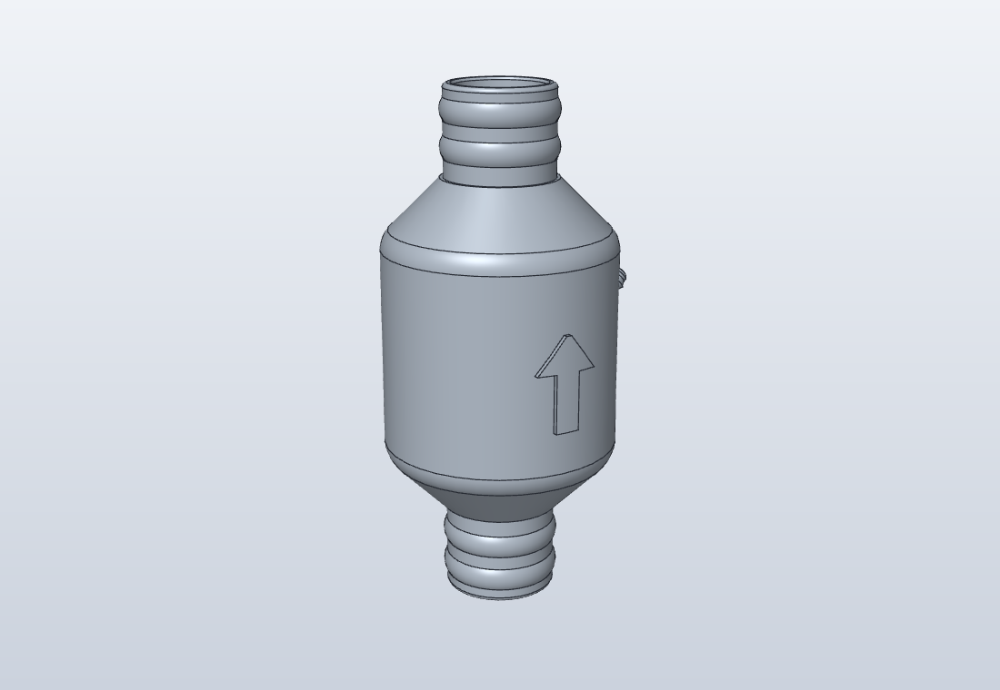
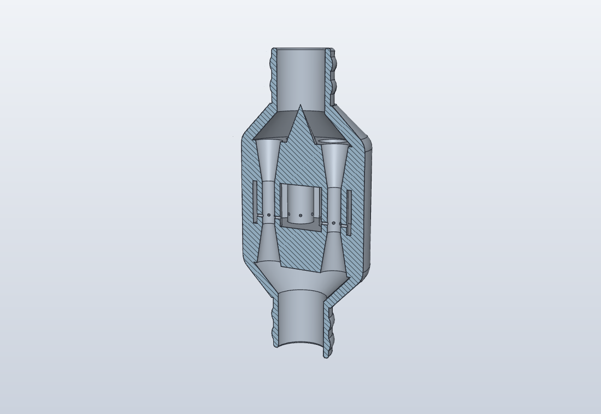
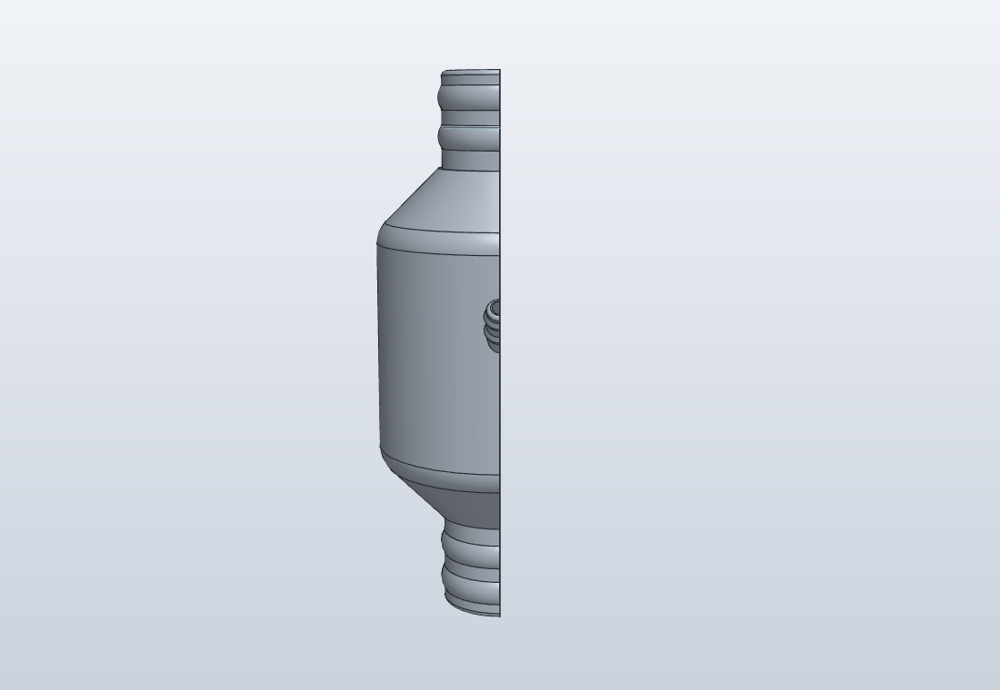

# Venturi aerator — 6-throat microbubble injector

A printable multi-throat Venturi aerator for a **2700 GPH** pump, using SolidCraft as a fully parametric model
(68 named parameters, no magic numbers in the features).



## Specs

| | |
|---|---|
| Inlet / outlet | 1" hose barbs, 20 mm bore, short rounded ridges for hose clamps |
| Air inlet | 3/16" hose barb at 45°, 1.5 mm feed bore |
| Throats | 6 × Ø5.5 mm × 16.5 mm long (3 × d) on a 14 mm ring |
| Nozzle / diffuser | 10° half-angle on both sides |
| Air injection | 36 × Ø1 mm holes — 6 per throat, 3 diametral pairs — at 20 % of the throat length |
| Air chamber | Ø42 × 16.5 mm internal cavity around the throat tubes |
| Impingement | Ø12 × 14 mm cone in the outlet chamber |
| Housing | Ø52 mm, r6 corner fillets, 5 mm wall over the air chamber |
| Tube roots | 1.5–1.8 mm 45° bevels where the throat tubes meet the air-chamber ceiling (they add material at the re-entrant corner) |
| Overall size | Ø52 × 114.7 mm tall |
| Volume / mass | 96,987.1 mm³ / 125.1 g in PETG |

## How it works

Water enters the bottom barb, opens through a 45° expansion into a plenum, and is
forced through six 10° nozzles into six Ø5.5 mm throats. The throats pass
through a sealed air chamber; each throat is drilled by six Ø1 mm holes at 20 %
of its length, so air is drawn from the chamber into the highest-velocity part of
the jet. The six diffusers (10°) discharge into a 45° collector and out the top
barb. A 12 mm cone sits in the collector to shear the plume once more before it
leaves.

The 6 throats give **142.5 mm²** of flow area — about 19.9 m/s at 2700 GPH,
roughly twice the area (and half the velocity) of a single 3/8" throat. That
keeps the venture out of hard cavitation while still breaking bubbles down.



## Printing

Print **upright**: inlet barb tip on the bed, outlet barb up. PETG or ASA,
0.2 mm layers, 5 perimeters, solid. No supports needed; the air barb is angled
45° for that reason. The plenum roof is a ~17 mm internal bridge — run full part
cooling.

## Tuning

`D_throat` is the first knob (5.0 / 5.5 / 6.0 mm). Everything downstream follows
it: throat length, nozzle and diffuser length, tube wall, air-hole height and the
air-barb position all recompute.

| `D_throat` | Volume | Throat area |
|---|---|---|
| 5.0 mm | 100,644.1 mm³ | 117.8 mm² |
| 5.5 mm | 96,987.1 mm³ | 142.5 mm² |
| 6.0 mm | 93,166.0 mm³ * | 169.6 mm² |

\* At 6.0 mm the two 1.8 mm tube-root chamfers no longer fit (the largest that
fits there is 1.599 mm), so those features report an error and the volume is
taken without them. Set all three chamfers to 1.5 mm before running a 6.0 mm
throat, or keep 5.5 mm.

Other useful knobs: `A_conv` / `A_div` (cone angles), `n_throat`, `R_ring`,
`D_air_hole`, `R_imp` / `L_imp` (impingement cone), `R_b2` / `L_b2` (air barb).

> Note: SolidCraft's `check_parameters` reports false fillet errors on this
> model. Real parameter edits (`set_parameter`, `parameters.change`) rebuild
> correctly — use those when tuning.

## Verification

- 1 closed body, 1 shell, 111 faces, no feature errors.
- Water path: inlet bore open into the plenum; all six throat bores pass a ray at
  r = 2.70 mm and block at r = 2.85 mm; all six paths reach the collector.
- Air chamber confirmed hollow (rays hit exactly r = 21 mm, floor 48.6, roof
  65.1); barb bore open, and all **36** air holes open into the throats
  (9 coaxial groups × 4 faces).
- Axis ray stops on the impingement cone apex at z = 94.68.



## Files

```
cad/Venturi-Aerator-v3.sc      parametric source (rebuilds on open)
cad/Venturi-Aerator-v3.step    STEP
stl/Venturi-Aerator-v3.stl     printable mesh
parameters.csv                 all 68 parameters
images/                        renders and sections
```

## Differences from the OpenSCAD source

The geometry matches `venturi_aerator_v3.scad`. Two intentional deviations:

- The 3/16" barb's two ridges are triangular (0.5 mm high × 2.5 mm wide) rather
  than sine-shaped; a torus at that size would need `minor > major`. The 1" barb
  ridges are true torus arcs (0.8 × 5 mm) matching the sine profile within
  ~0.01 mm.
- The SCAD's 0.01 mm tool overlaps are 0.05 mm here, which keeps the booleans
  clean with no visible effect.

## License

CC BY 4.0 — see [LICENSE](LICENSE).
